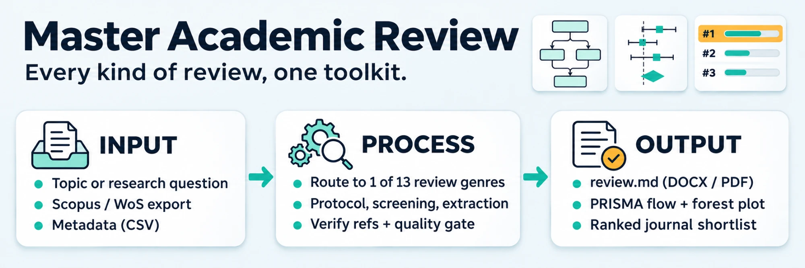

# Master Academic Review (Bahasa Indonesia)

<p align="center"></p>

[English](README.md) · **Bahasa Indonesia**

> **Semua jenis review, satu toolkit.** Kumpulan *agent skill* dan alat
> Python untuk **menulis artikel review**: dari resensi buku sampai
> meta-analisis dan realist review. Setiap genre punya protokol, standar
> pelaporan, dan (bila relevan) statistik yang dihitung oleh kode.

## Mulai Dari Sini: Anda Hanya Butuh Tiga Skill Inti

> **TL;DR:** Mulai dari `/mar-review` (Claude Code) atau `@review-router` (OpenCode). Router merekomendasikan satu genre; Anda menjalankan genre itu. `brainstorm` dan `journal-match` opsional.

Repositori ini punya 16 skill, tetapi satu review biasanya memakai **paling banyak tiga skill inti plus satu helper opsional**:

| Lapisan | Skill | Kapan Dipakai |
|---|---|---|
| Memutuskan | `brainstorm` | topik atau kata kunci masih kabur |
| Memutuskan | `review-router` | topik sudah ada, tetapi genre review belum tahu |
| Menulis | satu skill genre | router sudah merekomendasikan, atau Anda sudah tahu genrenya |
| Submit (opsional) | `journal-match` | butuh jurnal tujuan sebelum menulis atau sebelum submit |

**16 skill itu terdiri dari 1 brainstorm + 1 router + 1 journal matcher + 13 genre.** Skill adalah pilihan, bukan daftar yang harus dijalankan semua. `shared/` bukan skill tambahan; itu pustaka metode dan skrip yang dipakai skill genre.

### Sesi Pertama Anda

1. Buka repositori di Claude Code atau OpenCode.
2. Ketik `/mar-review` (Claude Code) atau `@review-router` (OpenCode). Jika sudah tahu genre, langsung ke `/mar-systematic-review`, `/mar-meta-analysis`, dan seterusnya.
3. Jawab empat pertanyaan router: **objek, tujuan, rigor, data**.
4. Setujui genre **#1**, pilih #2/#3, atau timpa rekomendasinya.
5. **Opsional:** jalankan `/mar-journal-match` sebelum menulis jika jurnal tujuan akan menentukan cakupan atau panjang naskah.
6. Jalankan skill genre yang dipilih. Skill akan meminta protokol, sumber, dan keputusan Anda.
7. Cek draf dengan `mar check-review review.md`. Jika melewati langkah 5, jalankan `/mar-journal-match` sekarang.

**Jika hanya ingat satu hal:** mulai dari `/mar-review`. Itu pintu masuknya; Anda tidak perlu memilih sendiri dari 13 genre.

### Alur

```
topik kabur
   │
   ▼
brainstorm? ──► pertanyaan + kata kunci (opsional)
   │
   ▼
review-router ──► genre #1 (+ #2/#3)
   │
   ├──► journal-match? ──► shortlist jurnal (opsional, sebelum menulis)
   │
   ▼
satu skill genre ──► review.md + artefak
   │
   ▼
check-review ──► export / submission
```

`brainstorm` opsional. `journal-match` opsional. Anda hanya menjalankan **satu** skill genre, bukan tiga belas.

### Pilih Titik Masuk

| Situasi Anda | Perintah Pertama | Selanjutnya |
|---|---|---|
| "Topik saya masih kabur" | `/mar-brainstorm` | `/mar-review` |
| "Topik sudah ada, jenis review belum tahu" | `/mar-review` | genre #1 |
| "Saya sudah tahu butuh systematic review" | `/mar-systematic-review` | protokol, pencarian, gate |
| "Draf sudah ada, butuh jurnal" | `/mar-journal-match` | cascade submit |
| "Saya hanya butuh alat" | `mar list` | `mar <tool>` |

### Sebelum Mulai

Siapkan ini, atau biarkan skill yang menanyakannya:

- topik atau pertanyaan penelitian satu kalimat;
- 2–3 database dan file ekspor untuk genre yang butuh protokol;
- kriteria inklusi dan eksklusi;
- tenggat dan budget APC untuk `journal-match`;
- aturan supervisor, etika, atau institusi.

> **Jangan memilih genre karena namanya terdengar keren.** Meta-analisis tanpa effect size yang sebanding bukan meta-analisis. Mulai dari pertanyaan, lalu biarkan router yang mengklasifikasikan.

**Apa ini, dan apa bukan.** Ini **bukan** pembuat paper otomatis. Alat ini
tidak menjalankan eksperimen dan tidak menghasilkan temuan baru. Keluarannya
satu jenis dokumen, yaitu **naskah review**, beserta artefak yang bisa diaudit:
diagram PRISMA, hasil deduplikasi, kappa, estimasi gabungan, dan laporan cek
referensi. Penulis tetap pengambil keputusan dan penanggung jawab ilmiah.

## Input → Proses → Output

| Input | Proses | Output |
|---|---|---|
| Topik / pertanyaan penelitian | Pilih 1 dari 13 genre review (`review-router`) | `review.md` (bisa diekspor ke DOCX / PDF) |
| Ekspor Scopus / PubMed / WoS (CSV, RIS, BibTeX) | Protokol → deduplikasi → skrining → ekstraksi | Diagram PRISMA, forest/funnel plot |
| Data effect size / tabel karakteristik (CSV) | Cek referensi + *gate* kualitas | Shortlist jurnal berperingkat, surat pengantar, balasan reviewer |

## JEV: Prioritas Di Setiap Keputusan

Setiap keputusan (database mana, model statistik apa, jurnal mana, komentar
reviewer mana dulu) disajikan sebagai **opsi berperingkat dengan #1
direkomendasikan**, disertai bukti satu baris dan alasan yang bisa mengubah
peringkat. Penulis yang memutuskan. Protokol lengkapnya ada di
[`shared/jev.md`](shared/jev.md), dan alat-alatnya mengikuti aturan yang sama:

- `dedup.py` menghapus duplikat yang pasti; yang meragukan hanya *direkomendasikan*.
- `journal_rank.py` memberi peringkat jurnal dengan **#1 recommended**.
- `check_review.py` mengurutkan perbaikan: integritas dulu, polesan terakhir.
- `submission.py` menulis surat untuk jurnal **#1** dan mengurutkan komentar reviewer (mayor dulu).

## Instalasi Alat (Terminal / PowerShell)

Butuh Python 3.10 atau lebih baru.

```bash
pip install masteracademicreview
```

Di Windows PowerShell, bila `pip` tidak dikenali:

```bash
py -m pip install masteracademicreview
```

Dengan dependensi opsional (meta-analisis, bibliometrik, ekspor Word/PDF):

```bash
pip install "masteracademicreview[all]"
```

Paket tersedia di PyPI: https://pypi.org/project/masteracademicreview/. Perbarui dengan `pip install -U masteracademicreview`.

Lalu jalankan:

```bash
mar list
```

Bila perintah `mar` tidak ditemukan (folder Scripts Python belum ada di PATH),
gunakan `python -m masteracademicreview list`.

| Langkah | Perintah | Fungsi |
|---|---|---|
| 1. Rencana | `mar protocol --template systematic-review` | protokol siap registrasi (PROSPERO/OSF) |
| 2. Pencarian | `mar dedup --source Scopus=scopus.csv --source PubMed=pubmed.ris` | hapus duplikat, angka PRISMA identifikasi |
| 3. Skrining | `mar screening-agreement screening_log.csv` | kappa Cohen dan PABAK |
| 3. Skrining | `mar prisma prisma_identification.json screening_counts.json` | diagram PRISMA 2020, angka harus cocok |
| 4. Ekstraksi | `mar validate-extraction effects.csv` | cek tabel ekstraksi |
| 5. Sintesis | `mar meta-selftest` | engine meta-analisis (REML, HKSJ, prediction interval) |
| 6. Cek | `mar verify-refs review.md` | integritas referensi (`--online` ke Crossref) |
| 6. Cek | `mar check-review review.md` | *gate* review |
| 7. Submit | `mar journal-rank journals.csv --explain` | shortlist jurnal berperingkat |
| 7. Submit | `mar submission cover-letter review.md --shortlist s.json --lang id` | surat pengantar berbahasa Indonesia |
| 7. Submit | `mar submission response komentar.txt --lang id` | kerangka balasan reviewer |
| 7. Submit | `mar export review.md` | DOCX / PDF |

## Memasang Skill (Untuk Claude Code Dan Lainnya)

Skill (`*/SKILL.md`) dipasang dengan meng-*clone* repositori; langkahnya ada di
[docs/INSTALL.md](docs/INSTALL.md). Paket pip berisi alat-alatnya, sedangkan
skill memanggil alat yang sama lewat `python shared/scripts/<alat>.py`.

## Cara Memanggil Skill

Di Claude Code, semua slash command diawali `mar-`, jadi cukup ketik `/mar` untuk melihat semuanya. Mulai dari `/mar-review` bila belum yakin genre apa yang dibutuhkan; skill akan mewawancarai Anda lalu merekomendasikan genre #1. Langsung ke genre tertentu: `/mar-systematic-review`, `/mar-meta-analysis`, `/mar-scoping-review`, dan seterusnya. Topik masih kabur: `/mar-brainstorm`. Jurnal tujuan: `/mar-journal-match`.

Di OpenCode, gunakan `@review-router`, `@brainstorm`, `@journal-match`, atau `@<genre>`. Anda juga bisa langsung mendeskripsikan tugasnya dalam kalimat biasa; skill yang cocok akan dimuat otomatis.

## Contoh Lengkap

[`examples/systematic-review-demo/`](examples/systematic-review-demo/) berisi
contoh systematic review sintetis yang menjalankan seluruh rantai dari tiga
ekspor database sampai surat pengantar:

```bash
python examples/systematic-review-demo/run_demo.py
```

Contoh surat pengantar dan balasan reviewer berbahasa Indonesia ada di
`cover_letter.id.md` dan `response_to_reviewers.id.md` pada folder yang sama.
Semua data di contoh ini **fiktif**.

## 13 Genre Review

| Genre | Kapan Dipakai | Standar |
|---|---|---|
| `book-review` | menilai satu buku | konvensi jurnal |
| `narrative-review` | ringkasan ahli tanpa protokol ketat | SANRA |
| `critical-review` | mengajukan tesis / menggugat asumsi | tidak ada checklist formal |
| `systematic-review` | menjawab pertanyaan terfokus secara reproducible | PRISMA 2020 |
| `meta-analysis` | menggabungkan effect size secara statistik | PRISMA 2020 + MOOSE + GRADE |
| `scoping-review` | memetakan luasnya bukti dan celahnya | PRISMA-ScR |
| `umbrella-review` | mensintesis review yang sudah ada | PRIOR + AMSTAR-2 |
| `meta-synthesis` | mensintesis studi kualitatif | ENTREQ |
| `rapid-review` | cepat, dengan jalan pintas yang dinyatakan | panduan Cochrane rapid review |
| `integrative-review` | menggabungkan desain beragam | Whittemore & Knafl |
| `mapping-review` | peta bukti dan celah | ROSES |
| `bibliometric-review` | memetakan struktur bidang dari ekspor Scopus | PRISMA (pencarian) + panduan bibliometrik |
| `realist-review` | apa yang berhasil, untuk siapa, dan mengapa | RAMESES |

Bingung memilih? Lihat [docs/id/PANDUAN.md](docs/id/PANDUAN.md) (pohon keputusan).

## Dokumentasi

- [Panduan singkat (pohon keputusan, alur kerja)](docs/id/PANDUAN.md)
- [FAQ](docs/id/FAQ.md)
- [Troubleshooting (bahasa Inggris)](docs/TROUBLESHOOTING.md)
- [Kontribusi](CONTRIBUTING.md) · [Kode etik](CODE_OF_CONDUCT.md) · [Keamanan](SECURITY.md)

## Catatan Jujur

- Alat ini **tidak menjamin** naskah diterima jurnal mana pun. Skor jurnal
  adalah ukuran kecocokan, bukan peluang diterima.
- Jangan pernah mengutip referensi yang belum diverifikasi; jalankan
  `mar verify-refs review.md --online`.
- Jangan *scraping* Scopus (melanggar ketentuan layanan); verifikasi metrik
  jurnal secara manual dan catat sumbernya.

Lisensi: MIT. Cara mensitasi: lihat [CITATION.cff](CITATION.cff).
