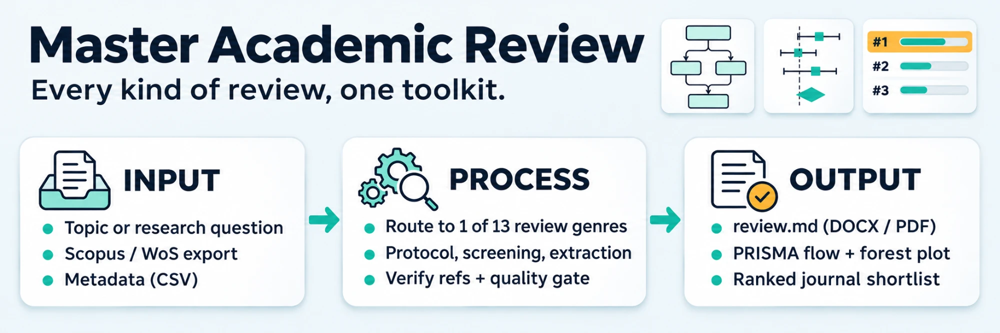

# Master Academic Review

<p align="center"></p>

[](https://pypi.org/project/masteracademicreview/)


**English** · [Bahasa Indonesia](README.id.md)

> **Every kind of review, one toolkit.** Agent skills and auditable tools for *writing reviews*, from a book review to a meta-analysis to a realist review, each with the right protocol, reporting standard, and (where it matters) real statistics.

The review is the product, and the first job is to work out *which* review you need. This is **not** a full-paper pipeline: it does not run experiments or generate findings. It produces a review document plus the artifacts that back it (PRISMA flow, pooled estimates, reference and gate reports). You stay the author; the suite owns the protocol, the checklist, and the arithmetic.

## Start Here

**Install once, open a new session, type `/mar-review`.** It asks four questions (object, purpose, rigor, data) and recommends one genre out of 13. You run that one.

| Your Situation | First Command |
|---|---|
| "I have no clear topic" | `/mar-brainstorm`, then `/mar-review` |
| "I have a topic but not the review type" | `/mar-review` |
| "I know I need a systematic review" | `/mar-systematic-review` |
| "I need a target journal" | `/mar-journal-match` |
| "I only need a tool" | `mar list` |

In OpenCode use `@review-router`, `@meta-analysis`, and so on. Typing `/mar` in Claude Code lists every command.

The 16 skills are **1 brainstorm + 1 router + 1 journal matcher + 13 genres**. They are alternatives, not a checklist: a normal review uses the router, one genre skill, and optionally the other two. `shared/` is the method library, not a skill.

## Install

**The tools** (gates, PRISMA, meta-analysis, and so on), as one command, `mar`:

```bash
pip install masteracademicreview
```

Use `"masteracademicreview[all]"` for the meta-analysis, bibliometric, and Word/PDF extras, and `py -m pip` if `pip` is not found on Windows.

**The skills and `/mar-*` commands**, for Claude Code and OpenCode: clone once, then run the installer. On Windows PowerShell use `$HOME`, not `~`:

```bash
git clone https://github.com/thabedtholibb/masteracademicreview.git "$HOME\masteracademicreview"
python "$HOME\masteracademicreview\install.py"
```

On Mac or Linux:

```bash
git clone https://github.com/thabedtholibb/masteracademicreview.git ~/masteracademicreview
python3 ~/masteracademicreview/install.py
```

Open a **new** session afterwards. Options (`--dry-run`, `--project`, `--uninstall`), updating, and manual install are in [docs/INSTALL.md](docs/INSTALL.md); if something does not appear, see [docs/TROUBLESHOOTING.md](docs/TROUBLESHOOTING.md).

## A Session In Seven Steps

1. `/mar-brainstorm` if the topic or keywords are still vague (optional).
2. `/mar-review`: answer the four questions, approve the **#1 genre** or pick #2/#3.
3. Write the protocol: `mar protocol --template <genre>` (registrable genres).
4. Run the genre skill. It asks for your sources and decisions; `mar dedup`, `mar prisma`, and the other tools do the counting.
5. `/mar-journal-match` before drafting (recommended) or once the draft exists.
6. `mar check-review review.md` and `mar verify-refs review.md` until there are no errors.
7. `mar submission cover-letter ...` and `mar export review.md`.

A full annotated session is in [docs/WALKTHROUGH.md](docs/WALKTHROUGH.md), and the whole chain runs on synthetic data in [examples/systematic-review-demo](examples/systematic-review-demo/): `python examples/systematic-review-demo/run_demo.py`.

> **Do not choose a genre because it sounds impressive.** A meta-analysis without comparable effect sizes is not a meta-analysis. Start with the question and let the router classify it.

## The Thirteen Genres

| Genre | What It Does | Reporting Standard |
|---|---|---|
| **Book review** | Critically assess a single book | Genre conventions |
| **Narrative review** | Broad expert synthesis of a field | SANRA |
| **Critical review** | Argue a conceptual thesis across literature | None (argument contract) |
| **Systematic review** | Reproducible, comprehensive synthesis | PRISMA 2020 |
| **Meta-analysis** | Statistically pool effect sizes | PRISMA + MOOSE, GRADE |
| **Scoping review** | Map the breadth of a field | PRISMA-ScR |
| **Umbrella review** | Synthesize existing reviews | PRIOR |
| **Meta-synthesis** | Qualitative evidence synthesis | ENTREQ |
| **Rapid review** | Streamlined systematic review | Cochrane rapid-review guidance |
| **Integrative review** | Combine diverse designs into a whole | Whittemore & Knafl |
| **Mapping review** | Visual evidence and gap map | ROSES / EGM |
| **Bibliometric review** | Citation and co-word analysis | PRISMA 2020 (search) |
| **Realist review** | Theory-driven explanation (CMO) | RAMESES |

Every standard is backed by a Crossref-verified citation in [`shared/method_sources.md`](shared/method_sources.md), which a monthly workflow re-checks. Critical and book reviews have no registered reporting guideline; the suite says so and uses an explicit internal contract rather than borrowing a standard that does not fit. Unsure which to pick? See the [decision tree](docs/DECISION_TREE.md).

## What You Get

One review document plus the artifacts behind it ([shared/output_spec.md](shared/output_spec.md)):

- **`review.md`**: title, a metadata block (review type, reporting standard, sources, search date, gate status), abstract, the genre's sections, references.
- **Artifacts per genre**: `prisma_flow.svg`, `forest.png`, `funnel.png`, `effects.csv`, `characteristics.csv`, and the reports `agreement.md`, `extraction_check.md`, `ref_check.md`, `review_check.md`.
- **`protocol.md`**, **`journal_shortlist.md`**, **`cover_letter.md`**, **`response_to_reviewers.md`**, and optional **`review.docx` / `review.pdf`**.

## Checks Built In

The suite does not ask you to trust arithmetic it cannot show. These tools are part of every genre's gate; they are offline (only `verify-refs --online` uses the network) and run in CI on Linux and Windows with Python 3.10–3.13.

| Command | What It Catches |
|---|---|
| `mar dedup` | duplicates across RIS, CSV, and BibTeX exports (DOI, then title and year); near-matches are listed for you to decide; writes the PRISMA identification counts |
| `mar prisma` | a flow diagram whose boxes do not add up; variants for scoping reviews and updates; SVG structure check |
| `mar screening-agreement` | Cohen's κ, PABAK, and a conflict list for dual screening |
| `mar validate-extraction` | non-finite effects, variance ≤ 0, bad sample sizes, duplicate rows, k < 2 and k < 10 guards |
| `mar verify-refs` | duplicate DOIs, citations without references, orphan references; `--online` checks DOI, title, and year against Crossref |
| `mar protocol` | a registration-ready protocol (PROSPERO/OSF fields) per genre; undecided fields stay `[TO COMPLETE]` |
| `mar check-review` | missing header fields or genre sections, unresolved citations, missing artifacts, leftover placeholders, a gate line that contradicts the checklist; reads UTF-8, UTF-16, and cp1252 files |
| `mar journal-rank` | a reproducible, anchored journal ranking from your verified evidence |
| `mar submission` | a cover letter for the #1 clean journal (refused while the gate fails) and a ranked response to reviewers; `--lang id` for Indonesian |

Meta-analysis uses a tested engine (DL, REML, Paule-Mandel, Hartung-Knapp, prediction interval, leave-one-out, subgroups, meta-regression, Egger with a k ≥ 10 guard, Doi plot and LFK checked against R `metasens`). Bibliometric reviews use a parser that reads real Scopus and WoS exports.

## JEV: Ranked Decisions

Every decision (which databases, which model, which journal, which reviewer comment first) is presented as **ranked options with a #1 recommendation**, one line of evidence each, and what would change the ranking. You decide; approved choices go into a decision log. The tools follow the same rule: `dedup` removes only certain duplicates and recommends the rest, `check-review` ranks fixes integrity-first, and `journal-match` verifies every quartile, APC, and decision time against a primary source with a check date, labelling anything unverified instead of filling it in. Protocol: [shared/jev.md](shared/jev.md).

## How It Differs

| Capability | Master Academic Review | Academic-Research-Skills (ARS) | AI-Scientist | Spark-To-Paper |
|---|---|---|---|---|
| Review as a *family of genres* (13 types) | ✅ | ⚠️ | ❌ | ❌ |
| Genres others skip (book, narrative, critical, umbrella, meta-synthesis, integrative, mapping, realist) | ✅ | ❌ | ❌ | ❌ |
| Ranked review-type router | ✅ | ❌ | ❌ | ❌ |
| Ranked journal shortlist with verified metrics | ✅ | ⚠️ | ❌ | ❌ |
| Real meta-analysis statistics (Python) | ✅ | ❌ | ❌ | ❌ |
| Deterministic reporting-standard gates | ✅ | ⚠️ | ❌ | ✅ |
| Focus on *reviews*, not papers | ✅ | ❌ | ❌ | ❌ |

✅ yes · ⚠️ partial · ❌ no

## Principles

- **AI is the copilot, not the author.** Every genre stops for your confirmation at decision points; you answer for every claim and every inclusion or exclusion.
- **Deterministic where it matters.** Search counts, screening tallies, PRISMA flow, and meta-analysis arithmetic are computed by code, never guessed by a model.
- **Reporting standards are gates, not suggestions.** A review that skips a PRISMA item is flagged, not silently passed.
- **Evidence over memory.** Metrics are verified against a primary source and date-stamped; unverified values are labelled, never invented.
- **Portable.** Plain `SKILL.md` frontmatter works across Claude Code, OpenCode, and other agent harnesses.

## Documentation

| For | Read |
|---|---|
| Choosing and using | [Decision tree](docs/DECISION_TREE.md) · [Usage](docs/USAGE.md) · [Skill-by-skill flows](docs/FLOWS.md) · [Walkthrough](docs/WALKTHROUGH.md) · [FAQ](docs/FAQ.md) |
| Setting up | [Install](docs/INSTALL.md) · [Troubleshooting](docs/TROUBLESHOOTING.md) |
| How it is built | [Architecture and layout](docs/ARCHITECTURE.md) · [JEV protocol](shared/jev.md) · [Method sources](shared/method_sources.md) · [Changelog](CHANGELOG.md) |
| Bahasa Indonesia | [README](README.id.md) · [Panduan](docs/id/PANDUAN.md) · [FAQ](docs/id/FAQ.md) |
| Community | [Contributing](CONTRIBUTING.md) · [Code of Conduct](CODE_OF_CONDUCT.md) · [Security](SECURITY.md) · [Cite](CITATION.cff) |

## License

MIT. See [LICENSE](LICENSE).
