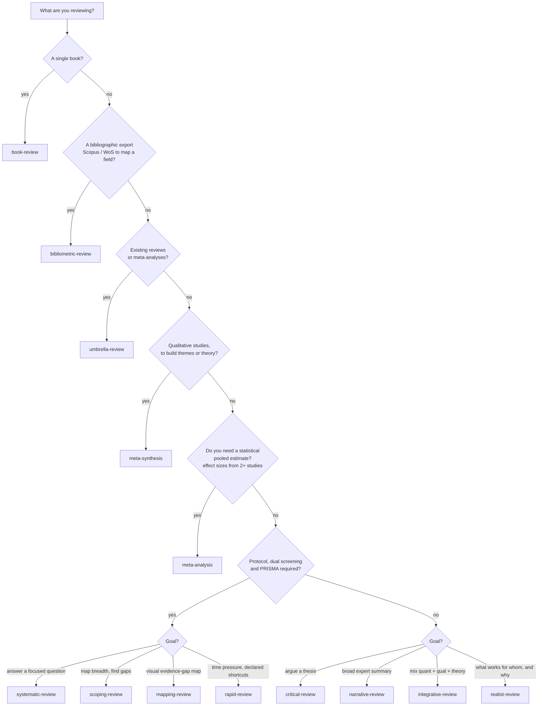

# Which Skill Do I Need?

The `review-router` skill asks these questions for you. This page is the same
logic on one screen, so you can pick a genre yourself (or sanity-check the
router's #1 recommendation).

**New to the suite?** Run `review-router` first (`/mar-review` in Claude Code,
`@review-router` in OpenCode). Use this tree only to understand or override its
recommendation.

## Decision Tree

## Same Logic As A Table

| If You Need To… | Use |
|---|---|
| evaluate one book | `book-review` |
| map a field from a Scopus/WoS export (trends, co-occurrence) | `bibliometric-review` |
| synthesize published reviews | `umbrella-review` |
| synthesize qualitative studies | `meta-synthesis` |
| pool effect sizes (means/SD, 2x2, correlations) | `meta-analysis` |
| answer a focused question, reproducibly | `systematic-review` |
| map the breadth of evidence and its gaps | `scoping-review` |
| draw an evidence-and-gap map against a framework | `mapping-review` |
| deliver fast, with named shortcuts | `rapid-review` |
| argue a conceptual position | `critical-review` |
| summarize a field without a strict protocol | `narrative-review` |
| combine diverse designs into one framework | `integrative-review` |
| explain what works, for whom, in which context | `realist-review` |
| find the right journal (before or after drafting) | `journal-match` |
| turn a vague topic into a question + keywords | `brainstorm` |

## Common Confusions

- **Systematic review vs meta-analysis.** A meta-analysis *is* a systematic
  review plus statistical pooling. If you cannot extract comparable effect
  sizes from at least two studies, you are writing a systematic review (with a
  narrative or structured synthesis), not a meta-analysis.
- **Scoping vs systematic.** Scoping asks "what exists?"; systematic asks "what
  does the evidence say?". A scoping review does not require quality appraisal
  and does not pool effects.
- **Scoping vs mapping.** Both map evidence. Choose mapping when the output is a
  visual evidence-and-gap map built on a coding framework.
- **Rapid vs systematic.** A rapid review is a systematic review with *declared*
  shortcuts (for example one screener, one database). The shortcuts must be
  listed in the Methods and the Limitations.
- **Narrative vs critical.** Narrative summarizes; critical argues a thesis.
- **Umbrella vs meta-analysis.** Umbrella synthesizes *reviews*; it does not
  re-pool primary studies and must report overlap between reviews.

If your request fits none of the thirteen genres (a new experiment, a grant
proposal, a full paper), this suite is not the right tool.

## What To Run Next

1. `review-router` (or this tree) picks the genre.
2. For registrable genres, write the protocol: `python shared/scripts/protocol.py --template <genre>`.
3. Run the genre skill; its gate decides when the review is done.
4. Validate the deliverable: `python shared/scripts/check_review.py review.md`.
