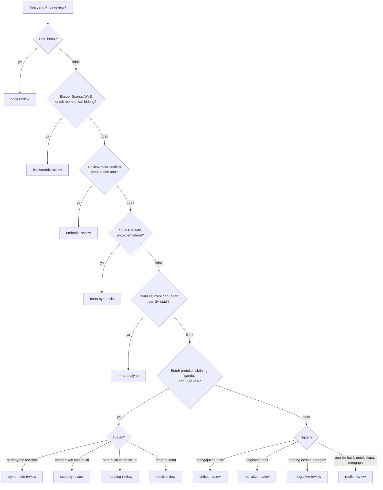

# Panduan Singkat

## 1. Skill Mana Yang Saya Butuhkan?

Skill `review-router` menanyakan ini untuk Anda. Pohon di bawah memakai logika
yang sama dan diurutkan JEV: pertanyaan yang paling menentukan ada di atas.

**Kebingungan yang sering terjadi**

- *Systematic review vs meta-analisis.* Meta-analisis adalah systematic review
  ditambah penggabungan statistik. Tanpa effect size yang sebanding dari minimal
  dua studi, yang Anda tulis adalah systematic review.
- *Scoping vs systematic.* Scoping bertanya "apa saja yang ada?", sedangkan
  systematic bertanya "apa kata buktinya?".
- *Rapid vs systematic.* Rapid review adalah systematic review dengan jalan
  pintas yang **dinyatakan** di Metode dan Keterbatasan.

## 2. Alur Kerja Systematic Review (Dengan Alat)

| # | Langkah | Perintah | Hasil |
|---:|---|---|---|
| 1 | Protokol | `mar protocol --template systematic-review > protocol.json`, lalu `mar protocol protocol.json --out protocol.md` | protokol untuk PROSPERO/OSF |
| 2 | Pencarian dan deduplikasi | `mar dedup --source Scopus=scopus.csv --source PubMed=pubmed.ris --source WoS=wos.bib` | `deduplicated.csv`, `possible_duplicates.csv`, `prisma_identification.json` |
| 3 | Skrining ganda | isi `screening_template.csv`, lalu `mar screening-agreement screening_template.csv` | kappa, PABAK, daftar konflik |
| 4 | Diagram PRISMA | `mar prisma prisma_identification.json screening_counts.json --strict` | `prisma_flow.svg` (angka wajib cocok) |
| 5 | Ekstraksi | `mar validate-extraction characteristics.csv --profile generic` | laporan validasi |
| 6 | Cek referensi | `mar verify-refs review.md --online` | `ref_check.md` |
| 7 | Gate | `mar check-review review.md --out review_check.md` | langkah perbaikan berperingkat |
| 8 | Pilih jurnal | `mar journal-rank journals.csv --explain --json shortlist.json` | shortlist, #1 direkomendasikan |
| 9 | Surat pengantar | `mar submission cover-letter review.md --shortlist shortlist.json --gate-report review_check.md --lang id` | `cover_letter.md` |
| 10 | Revisi | `mar submission response komentar.txt --review review.md --lang id` | rencana revisi dan balasan per poin |

**Prinsip deduplikasi (JEV).** Duplikat yang pasti (DOI sama; judul dan tahun
sama) dihapus otomatis. Pasangan yang hanya *mirip* (misalnya salah ketik) masuk
`possible_duplicates.csv` untuk dicek manusia. Setelah dicek, jalankan ulang
dengan `--merge-possible`.

**Surat pengantar ditolak bila:** gate `failed`, laporan gate masih ada error,
atau jurnal #1 ditandai `LEGITIMACY RISK` / `SCOPE MISMATCH`. Dalam kasus
terakhir, alat menyebutkan kandidat bersih berikutnya.

## 3. Masalah Umum

| Masalah | Solusi |
|---|---|
| `mar` tidak dikenali | `python -m masteracademicreview ...`, atau tambahkan folder Scripts Python ke PATH |
| `pip` tidak dikenali (Windows) | `py -m pip install ...` |
| Huruf aneh di konsol Windows | `$env:PYTHONUTF8 = "1"` (PowerShell), atau tulis laporan ke file dengan `--out` |
| Ekspor Scopus tidak terbaca | `mar bib-validate scopus.csv`; ekspor ulang langsung dari Scopus, jangan disimpan ulang lewat Excel |
| `ModuleNotFoundError: numpy` | `pip install "masteracademicreview[all]"` |

Lebih lengkap (bahasa Inggris): [docs/TROUBLESHOOTING.md](../TROUBLESHOOTING.md).
